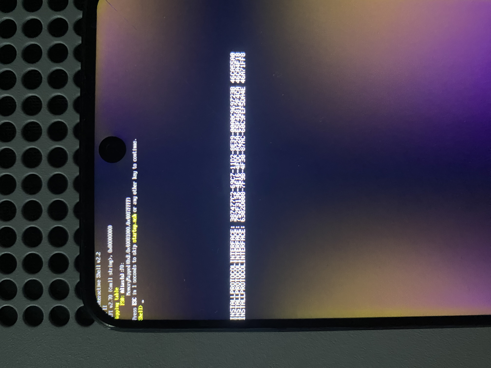

# Primer arranque UEFI Shell en Redmi Note 11S

El 17 de octubre de 2026, el Redmi Note 11S 4G **miel / MT6781 / 2201117SL**
alcanzó el prompt **`Shell>`** del EDK2 nativo. El usuario lo confirmó y envió
esta fotografía. La sesión terminó con boot stock restaurado y Android arrancado.



## Lo que muestra la foto

La parte izquierda de la cabecera queda parcialmente fuera del encuadre.
Se distinguen `Shell v2.2`, `v2.70`, la tabla de mapeos con `FS0:` y el prompt.
Extracto de las líneas legibles:

```text
Mapping table
FS0: ...
Press ESC in 1 seconds to skip startup.nsh or any other key to continue.
Shell>
```

`...` indica texto omitido, no caracteres transcritos de la pantalla.
También aparecen mensajes `INSTALLPROTOCOLINTERFACE` del log de depuración.
La copia publicada conserva la foto completa; no se ha recortado ni retocado.

El prompt demuestra que la aplicación Shell se ejecutó y produjo salida visible.
La única ruta de esta plataforma hasta Shell pasa por la interpretación del
handoff, la aprobación del FD/heap, MMU, HOBs, DXE, BDS y la consola gráfica.
Esas etapas se infieren del flujo del código probado; esta foto no contiene
un volcado de sus valores ni del mapa completo de memoria.

El mapeo `FS0` usa el sistema de archivos del volumen de firmware en memoria.
El acceso a eMMC, teclado, táctil, USB de UEFI y arranque de un sistema operativo
quedan pendientes de pruebas específicas.

## Cambio que permitió avanzar

La [traza anterior](2026-10-17-sec-status-length.md) detuvo el SEC en `status`
de `/reserved-memory/reserve-memory-sspm_share`: LK entrega los cuatro bytes
`okay` sin NUL. El cambio `52e4a84` acepta exactamente esa variante en nodos de
reservas y conserva la región y su atributo `no-map`. Mantiene el rechazo de
estados desconocidos y no aplica la excepción a bancos de RAM.

Las pruebas de host con ASan/UBSan cubren esa reserva, entradas malformadas,
salida atómica y 512 corrupciones del árbol. El código también compiló para
AArch64, el FD pasó su inspección y el empaquetado verificó la imagen antes de
la escritura temporal.

## Identidad de la prueba

| Dato | Valor |
| --- | --- |
| Fuente funcional probada | commit `52e4a84` |
| Core EDK2 | `b03a21a63e3bd001f52c527e5a57feddb53a690b` |
| FD nativo, SHA-256 | `cbeb50d923c533dc05e53c87bd05e2ce8cb978e51aca8e241aec0ad789181c58` |
| Imagen boot privada, SHA-256 | `24292d411ce7338a3af18b8353ab5819084c496c1af5b41a4cd2358fdfc45bde` |
| Batería antes del ensayo | 63 % |
| Transporte seleccionado | USB |
| Escritura temporal | solo `boot_a` |
| Evidencia física | confirmación del usuario y fotografía con `Shell>` |
| Resultado final | stock restaurado; `sys.boot_completed=1`, fingerprint y slot `_a` comprobados |

La primera ventana de observación de Fastboot, de 120 segundos, venció sin
detectarlo. La fase posterior de recuperación sí encontró el mismo Fastboot
USB y restauró el boot original; no se midió la latencia total de retorno.
Los 120,625 segundos del registro son el plazo de esa primera ventana, **no**
un tiempo medido de arranque de Shell ni de retorno a Fastboot.

La imagen conserva el DTB stock y transporta el FD con gzip y ramdisk vacía.
No contiene kernel Linux, userspace ni BootShim. Las imágenes stock y de prueba
y los registros USB completos permanecen privados en `Local/`.

## Integridad de la fotografía

Se retiraron GPS y metadatos de cámara. Se conservaron orientación, perfil ICC
y flujo principal JPEG byte por byte, sin recomprimir ni generar píxeles.
El original permanece privado. Los hashes están en el
[registro de integridad](2026-10-17-first-uefi-shell.json).

## Cierre de la sesión

Se cumple el hito de **primer arranque UEFI verificable en el dispositivo**.
El usuario pidió terminar las pruebas con este teléfono por hoy. Para la próxima
sesión quedan entrada de usuario, almacenamiento/USB y consolidación del mapa
de memoria y del arranque de sistemas operativos. El estado por etapas está en
[physical-tests.json](../physical-tests.json).
