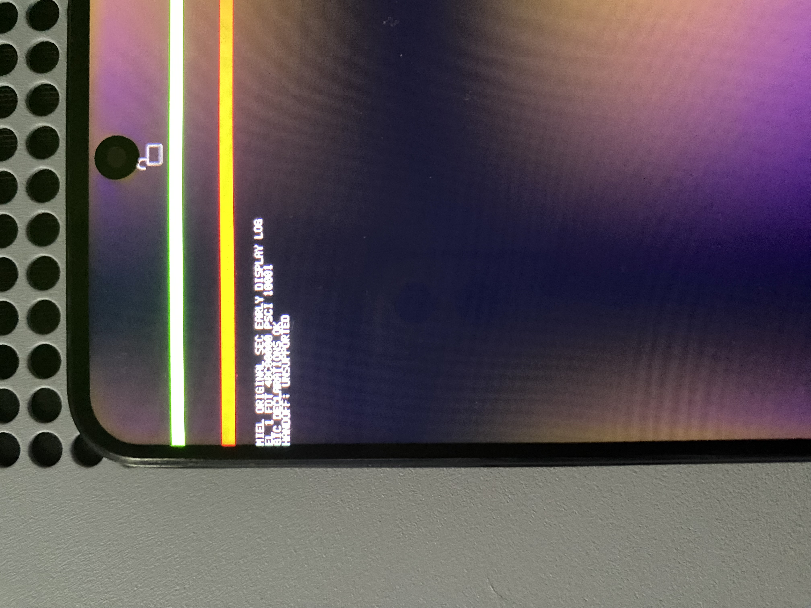

# Redmi Note 11S: consola SEC física y handoff pendiente

Fecha: 17 de octubre de 2026. Equipo de la sesión: Redmi Note 11S 4G,
`miel`, modelo 2201117SL, MT6781, seleccionado exclusivamente por USB.



## Texto observado

Transcripción manual de la fotografía enviada por el usuario:

```text
MIEL ORIGINAL SEC EARLY DISPLAY LOG
EL 1 FDT 4BC80000 PSCI 10001
GIC DECLARATIONS OK
HANDOFF: UNSUPPORTED
```

La imagen aporta evidencia física de ejecución del SEC nativo y de la consola
temprana sobre el framebuffer. El código reporta EL1, un puntero FDT en
`0x4bc80000` y el valor PSCI `0x00010001`. Las declaraciones GIC del DTB coinciden
con el perfil; esto todavía no verifica el funcionamiento de sus interrupciones.

`UNSUPPORTED` es el resultado de `MielInspectHandoff`. **Todavía no se ha localizado
qué condición de su intérprete provoca ese resultado.** No debe atribuirse sin
más a la RAM, al framebuffer ni a un DTB inválido. Según la secuencia del código,
el retorno de error detiene el arranque antes de `MielPlanEarlyMemory`, MMU,
DXE y Shell. Por eso no aparece una línea `MEMORY PLAN` en esta foto.

## Compilación y recuperación

| Dato | Valor |
| --- | --- |
| Fuente del port | commit `b3528bb` |
| Core EDK2 | `b03a21a63e3bd001f52c527e5a57feddb53a690b` |
| Modo de laboratorio | `shell`, con consola previa al heap |
| Imagen privada probada, SHA-256 | `3c2010095444c2891830fd612907366ec5895ec30072104d7960409caeba0f0c` |
| Partición temporal | `boot_a` |
| Retorno observado a Fastboot | 53,31 s desde la orden de reinicio del host |
| Recuperación | boot stock restaurado; Android completó el arranque por USB |
| DXE / GOP / Shell | sin verificar en esta prueba |

El plazo incluye carga del bootloader y reconexión USB; no es una medida aislada
de ejecución SEC. La imagen conserva el DTB stock y transporta el FD nativo con
gzip. No contiene kernel Linux, userspace, BootShim ni un segundo cargador.
El resumen de sesiones está en [physical-tests.json](../physical-tests.json).

La consola temprana conserva su estado dentro del SEC cargado. Su prueba de host
funciona con toda la página del log compartido protegida mediante PROT_NONE;
por tanto, este mensaje puede obtenerse sin utilizar el heap candidato.

## Integridad de la fotografía

Se publica una copia sin GPS ni metadatos de cámara. Se conservaron la orientación,
el perfil ICC y el flujo principal JPEG **byte por byte**, sin recomprimir píxeles,
recortar, retocar ni generar contenido. El original permanece privado en `Local/`.
Los hashes del original, la copia y el flujo JPEG están en el
[registro de integridad](2026-10-17-sec-handoff-unsupported.json).

El siguiente paso es instrumentar el intérprete para identificar el nodo o la
propiedad que devuelve `EFI_UNSUPPORTED`, manteniendo las comprobaciones de RAM
y reservas antes de habilitar el heap.

Actualización: una [segunda fotografía con traza](2026-10-17-sec-status-length.md)
localiza el rechazo en `status` de `reserve-memory-sspm_share`, con longitud 4.
