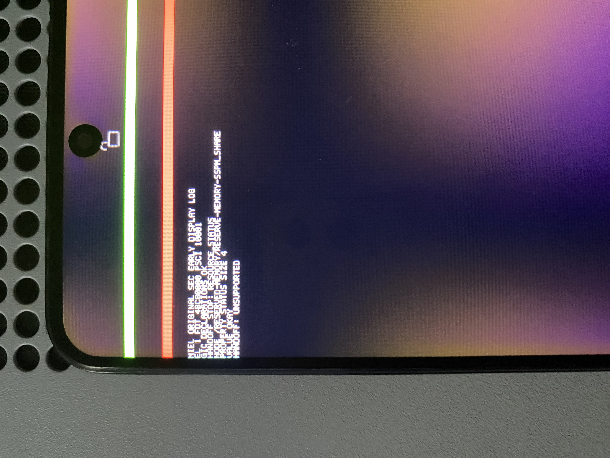

# Redmi Note 11S: rechazo localizado en `status` de SSPM

Fecha: 17 de octubre de 2026. Redmi Note 11S 4G `miel`, MT6781,
seleccionado exclusivamente por USB.



## Transcripción de la fotografía

```text
MIEL ORIGINAL SEC EARLY DISPLAY LOG
EL 1 FDT 4BC80000 PSCI 10001
GIC DECLARATIONS OK
HANDOFF STOP: RESOURCE_STATUS
NODE /RESERVED-MEMORY/RESERVE-MEMORY-SSPM_SHARE
PROPERTY STATUS SIZE 4
VALUE OKAY
HANDOFF: UNSUPPORTED
```

Esta prueba añade la traza que faltaba en la
[fotografía anterior](2026-10-17-sec-handoff-unsupported.md). El nodo original es
`/reserved-memory/reserve-memory-sspm_share` y la propiedad es `status`.
La consola dibuja las letras en mayúsculas; la foto por sí sola no distingue
las mayúsculas y minúsculas de los cuatro bytes originales.

El análisis estático del LK stock identifica la misma ruta de nodo. En el
offset `0x1f850` llama a una rutina con semántica de `strlen` sobre el literal
minúsculo `okay`, guarda el resultado como quinto argumento y, en `0x1f860`,
lo entrega a la rutina de escritura de propiedades con nombre `status`.
No suma uno a la longitud. Esto apoya de forma independiente la interpretación
de cuatro bytes minúsculos sin NUL; es evidencia estática, no una captura cruda
del FDT de este arranque. El binario de referencia permanece privado.
SHA-256 del payload LK analizado:
`56a596c303312a6aeacb8ba322fb0d63fdc933f8cbcbdce5b9d21e3644606c61`.

La condición exacta que detiene el código probado está identificada:
`ResourceEnabled` solo reconoce `okay` con longitud 5, incluido el NUL final.
El árbol entregado en este arranque declara una longitud de **4** y muestra
`OKAY`. Es consistente con `okay` sin terminador. La
[especificación Devicetree](https://devicetree-specification.readthedocs.io/en/stable/devicetree-basics.html#property-values)
define los valores de tipo string con un NUL final; esta variante se trata como
una excepción de compatibilidad del handoff.

La corrección preparada acepta solo los cuatro bytes minúsculos `okay` en
nodos de reservas. No aplica la excepción a bancos de RAM ni reconoce estados
desconocidos. Las pruebas de host con ASan/UBSan verifican que la reserva SSPM
completa y su atributo `no-map` se conservan, y rechazan mayúsculas, prefijos,
NULs incrustados y estados desconocidos. La corrección queda pendiente de
verificación física; esta fotografía corresponde al código anterior al cambio.

Todavía no se alcanzan el plan de memoria, MMU, DXE ni Shell. La foto tampoco
demuestra un problema en la memoria SSPM ni autoriza reutilizar su reserva.

## Imagen probada y recuperación

| Dato | Valor |
| --- | --- |
| Fuente del port | commit `b932cbc` |
| Core EDK2 | `b03a21a63e3bd001f52c527e5a57feddb53a690b` |
| Imagen privada, SHA-256 | `eb002a36e3743c1edc5d1225ebc6ddd72b6347e84e5b7321fb56bda5ec37167d` |
| Batería antes del ensayo | 62 % |
| Partición temporal | `boot_a` |
| Retorno observado a Fastboot | 54,28 s desde la orden de reinicio del host |
| Recuperación | boot stock restaurado; Android completó el arranque por USB |

El tiempo incluye carga del bootloader y reconexión USB. Se conserva el DTB
stock en la imagen de prueba; LK realiza sus modificaciones de arranque.
La imagen nativa transporta el FD mediante gzip y no contiene kernel Linux,
userspace, BootShim ni un segundo cargador.

## Integridad de la fotografía

Se publica una copia sin GPS ni metadatos de cámara. Se conservan orientación,
perfil ICC y flujo principal JPEG byte por byte, sin recomprimir, recortar,
retocar ni generar píxeles. El original permanece privado en `Local/`.
El [registro de integridad](2026-10-17-sec-status-length.json) contiene los hashes.

Actualización: la [prueba posterior alcanzó `Shell>`](2026-10-17-first-uefi-shell.md)
con esta corrección, quedó fotografiada y terminó con Android stock restaurado.
